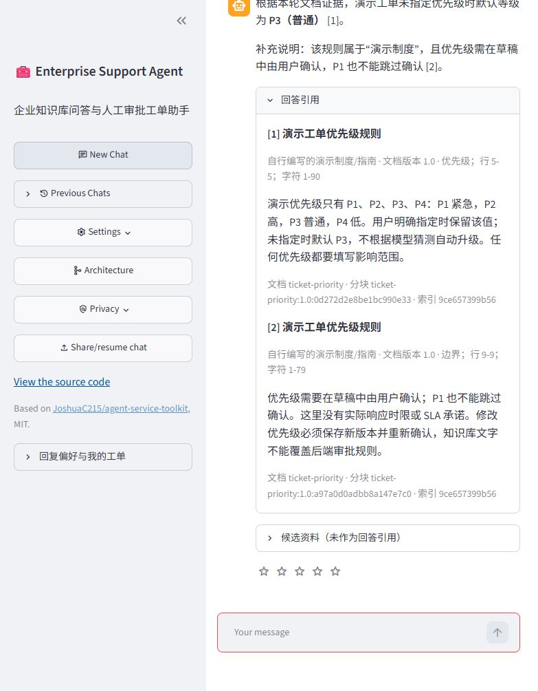
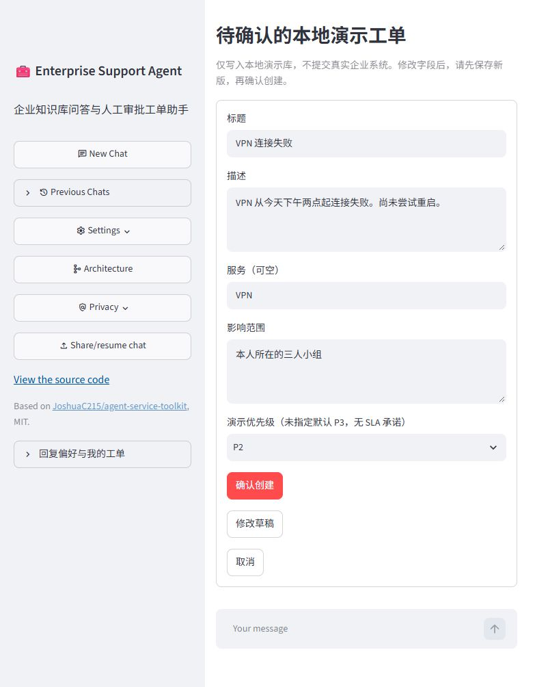
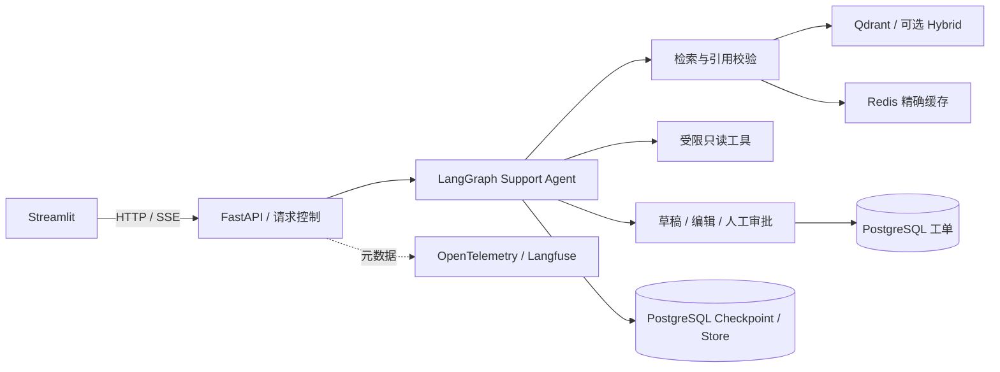

# Enterprise Support Agent

**企业知识库与智能工单 Agent：从有据回答，到人工批准，再到可恢复的业务写入。**

[](https://github.com/penpendashuai-alt/enterprise-support-agent/actions/workflows/test.yml)
[](pyproject.toml)
[](LICENSE)

面向企业 IT 支持场景，将知识检索、只读诊断、事实抽取、草稿编辑与工单审批串成可持久化的 LangGraph 工作流。重点解决三类问题：回答能否找到依据、业务写入是否经过用户确认、故障重试是否产生重复工单。

[项目导览与源码](docs/project-tour.md) · [真实模型演示](evaluation/resume-improvement/20261022-r1/demo/README.md) · [评测结果](evaluation/resume-improvement/20261022-r1/README.md) · [快速开始](#快速开始) · [部署与恢复](docs/deployment.md)

**技术栈**：Python · LangGraph · FastAPI / SSE · Streamlit · PostgreSQL · Qdrant · Redis · OpenTelemetry / Langfuse。Elasticsearch / RRF / Reranker 提供可选检索对照。

## 核心能力

| 能力 | 实现要点 | 源码入口 |
| --- | --- | --- |
| 受控 Agent 工作流 | 结构化意图路由、缺信息澄清、独立检索、按意图限制工具集合 | [Support Agent](src/agents/support_agent.py) |
| 有据知识问答 | 文档版本与来源定位、证据预算、引用编号校验；区分无答案与检索故障 | [RAG](src/rag/retriever.py)、[回答校验](src/rag/answers.py) |
| 人工审批工单 | 草稿可编辑；版本与内容指纹绑定批准，旧批准失效 | [审批图](src/agents/ticket_flow.py)、[创建服务](src/tickets/service.py) |
| 持久化与恢复 | PostgreSQL 保存图检查点、显式偏好和工单；唯一约束与原请求核查处理重复批准 | [存储层](src/support_storage/)、[审批回归](tests/service/test_ticket_approval.py) |
| 性能与可观测性 | Redis 精确检索缓存、有界并发、超时与限流；白名单元数据追踪 | [执行控制](src/execution/)、[缓存](src/rag/cache.py) |
| 可复算评测 | 冻结基线与候选、家族划分留出集、配对运行、分层评分、物理请求费用账本 | [评测工具](scripts/resume_support/)、[完整记录](evaluation/resume-improvement/20261022-r1/) |

## 实际界面

以下截图来自真实模型、36 篇演示资料 / 72 个正式索引块及实际 PostgreSQL 的浏览器验证。服务和设备工具使用固定模拟数据；批准后的 DEMO 工单实际入库。

| 知识回答与来源展开 | 编辑后的草稿在服务重启后恢复 |
| --- | --- |
|  |  |

演示核验了“缺影响范围先澄清 → 编辑保存 v2 → 拒绝 v1 批准 → 重启恢复 → 批准 v2 → 重放仍为同一工单”，数据库最终仅有 1 条对应记录。[完整操作记录、截图与数据库断言](evaluation/resume-improvement/20261022-r1/demo/README.md)。

## 验证结果

最近一轮验证于 **2026-10-22～24** 完成；新建 80 个合成 Agent 任务、120 条检索查询，分别划分开发集与留出集。开发集最多比较两轮候选，留出运行前冻结源码和配置。

| 验证对象 | 结果 | 口径 |
| --- | --- | --- |
| 草稿任务 | **4/10 → 9/10** 生成且忠实完成 | 留出集 10 个预期生成草稿的任务，5 个家族；已生成草稿忠实度分别为 4/4、9/9 |
| 检索缓存 | **272 ms → 47 ms** 平均组件耗时 | 20 查询各重复 2 次，无缓存 / 预热各 40 次；预热实际 36 hit / 4 miss，36 次命中无 Embedding 调用 |
| 检索证据 | **38/45** 必要证据完整覆盖 | 新留出集 45 个可答题；另 15 个无答案题中 1 个返回证据，独立于最终回答质量 |
| 工程回归 | **408 passed / 4 skipped**；**13 项容器检查** | 当次仓库整体测试含上游；容器验证使用确定性模型和真实基础设施 |

草稿改进来自事实状态与字段职责约束；缓存结果是组件时延。整体 Agent 完整成功为 27/40 → 32/40，但家族簇差值区间包含 0，且保留知识回答退化与数据库中断，未证明整体显著提升。[改进案例](evaluation/resume-improvement/20261022-r1/case-studies.md) · [性能方法与结果](evaluation/resume-improvement/20261022-r1/performance/results.md) · [逐项证据](evaluation/resume-improvement/20261022-r1/claim-evidence.md)。

## 架构



[实际图节点与存储职责](docs/architecture.md) · [批准绑定、写入核查与失败策略](docs/design_decisions.md)。

## 快速开始

前提：Git、Docker Engine/Desktop 与 Compose 2.24.4+；首次构建建议预留至少 20 GB 磁盘。Python 工具使用 3.12～3.14，仓库锁定 uv 0.12.5；容器按 uv.lock 构建。以下命令从仓库根目录执行。

### 确定性演示：不需要个人模型密钥

```sh
git clone https://github.com/penpendashuai-alt/enterprise-support-agent.git
cd enterprise-support-agent
docker compose --env-file docker/ci.env -p esa-p10-demo -f compose.yaml -f compose.local.yaml -f compose.ci.yaml up -d --build --wait
```

访问 <http://127.0.0.1:8501>，Service 为 <http://127.0.0.1:8080>。使用新的项目名隔离日常数据。CI 配置显式启用 fake 模型与本地单块 MFA 知识，迁移和 index 初始化完成后 Service 启动；不存在“缺密钥自动成功”的 fallback。按 [演示脚本](docs/demo.md) 输入固定示例，这个模式不理解任意自然语言。

停止且保留演示数据：

```sh
docker compose --env-file docker/ci.env -p esa-p10-demo -f compose.yaml -f compose.local.yaml -f compose.ci.yaml down
```

### 真实模型运行

复制 [docker/compose.env.example](docker/compose.env.example) 为私有 `.env.compose`，填写聊天、Embedding、已有 Qdrant v2 collection、共享 Bearer 和数据库密码；不提交个人配置。默认采用 Dense20/v2，启动不自动付费向量化。

```sh
docker compose --env-file .env.compose -p esa-demo config --quiet
docker compose --env-file .env.compose -p esa-demo up -d --build --wait
```

访问相同默认端口。缺失/不兼容知识索引会显示检索不可用；核心健康不代表真实模型或索引可调用。首次知识导入需要单独准备、预算与契约核对，详见 [部署](docs/deployment.md)。Hybrid/重排为可选组件，需要配对索引和独立配置，不属于默认启动栈。

## 开发与验证

```sh
uv sync --frozen
uv run ruff check
uv run ruff format --check
uv run pyrefly check
uv run pytest
python scripts/summarize_phase10.py --check
```

普通测试隔离付费外部请求。GitHub Actions 覆盖 Python 3.12 / 3.13 / 3.14，独立容器任务验证业务恢复、Redis 压力与追踪导出；离线评测汇总无需模型密钥。[最新评测复算命令](evaluation/resume-improvement/20261022-r1/README.md#无付费复算)。

## 文档导航

| 内容 | 入口 |
| --- | --- |
| 项目改造与关键源码 | [项目导览](docs/project-tour.md)、[架构](docs/architecture.md)、[设计决策](docs/design_decisions.md) |
| 运行与演示 | [免模型密钥演示](docs/demo.md)、[真实模型演示记录](evaluation/resume-improvement/20261022-r1/demo/README.md)、[部署](docs/deployment.md)、[运维](docs/operations.md) |
| 质量与性能 | [最新完整报告](evaluation/resume-improvement/20261022-r1/README.md)、[指标解释](docs/evaluation.md)、[七组检索对照](docs/rag_experiments.md) |
| 历史结果与原始记录 | [历史 Benchmark](benchmarks/results.md)、[阶段索引](evaluation/README.md) |

## 适用范围

这是使用合成企业资料与公开技术摘要构建的工程演示项目，目前限定单 worker、共享 Bearer 和客户端声明身份，尚未实现完整登录、多租户权限或生产 SLA。语义审阅由同一开发助手完成，属于非独立审阅；小规模同语料评测不能外推真实企业效果。已知失败与结果分母保留在完整报告中。

## 上游与改造范围

本项目 Fork 自 [JoshuaC215/agent-service-toolkit](https://github.com/JoshuaC215/agent-service-toolkit)。上游提供 LangGraph / FastAPI 服务骨架、AgentClient、Streamlit、SSE、多模型适配与基础测试。本 Fork 在此基础上新增企业支持业务图、Qdrant 检索与实验、版本化人工审批、PostgreSQL 业务恢复、Redis 执行保护和可复算评测；详细映射见 [项目导览](docs/project-tour.md)。代码开发使用 AI 辅助。

保留上游版权与 [MIT License](LICENSE)。
