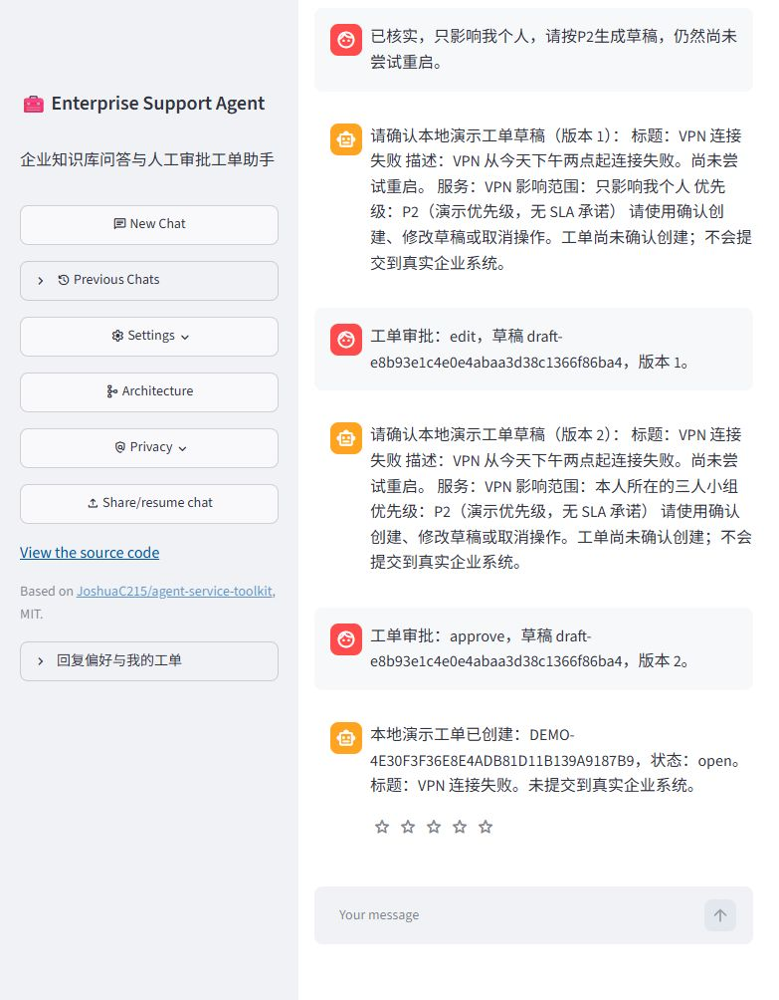

# 最终真实浏览器演示

2026-10-23至24日，候选v2冻结后执行。浏览器使用Streamlit UI与本地API，DeepSeek `deepseek-v4-pro`、temperature 0、输出上限1800、thinking disabled、自动重试0。Embedding为DashScope `text-embedding-v3` 1024维；本地Qdrant为正式36篇72块，snapshot `5b61873311a832a29a4289ef9607daf4391004fd8c00af146fd397bc19bf682c`。本次使用Dense默认方案。

服务开启Bearer鉴权，监听127.0.0.1:18881，UI为18851；使用专属PostgreSQL库和Redis命名空间。密钥、连接配置留在忽略目录，不进入证据。每次启动的 `browser/server-*.json` 记录源码摘要及正式索引契约；`browser/browser-*.json` 保存脱敏HTTP请求、响应、SSE、请求ID及计时头。模型请求进入专项同一本账。

## 已执行场景

| 场景 | 实际行为与断言 | 主要证据（browser/下） |
| --- | --- | --- |
| 知识与引用 | 默认优先级P3，附演示制度条款及批准要求；正式块可定位 | knowledge-recovered.png；browser-05d932114f2c4b50828c0f79f8412f1f.json |
| 无答案 | GPU报销额度没有依据，明确不能给数值；0工单 | no-answer.png；no-answer-db.json |
| 检索故障 | 暂停专属Qdrant时提示暂不可用，并明确不等于没有资料；恢复后P3问题可答 | retrieval-unavailable.png；unavailable-db.json；knowledge-recovered.png |
| 缺信息 | 影响范围未核实时先澄清，0工单 | missing-impact-db.json；browser-5d78bac8828b40a8b4138f700b969ef1.json |
| 生成及编辑 | 补充个人影响后生成v1；UI将范围改为三人小组并保存v2，仍0工单 | draft-v1-db.json；draft-v2-db.json |
| 旧批准 | HTTP重放已观察到的v1批准，409拒绝，v2仍待批且0工单 | stale-v1-db.json |
| 待审批恢复 | 重启API后v2仍在；隔夜Docker及API/UI重新启动后，浏览器恢复同一会话与v2表单，0工单 | restarted-pending-db.json；overnight-pending-db.json；pending-recovered.png |
| 创建与防重 | UI批准v2后1张工单；HTTP重放v2批准返回同一ticket_id，仍1张；刷新历史恢复且无待批表单 | approved-v2-db.json；repeated-v2-db.json；ticket-completed-recovered.png |
| 模拟只读工具 | DEV-001返回Windows 11/VPN客户端5.0，明确固定模拟数据，无检索前置阻断且0工单 | mock-device.png；mock-device-db.json；browser-0723af8c1f144f558c06e179ee97bbfe.json |

演示身份为新建合成用户 `b5d0cbfd-f715-4da5-a1e2-52bb8629dc60`。审批线程 `01c1dd2a-45d9-4585-864c-41ebc966a3ef`，工单 `DEMO-4E30F3F36E8E4ADB81D11B139A9187B9`。入库v2的描述保留“尚未尝试重启”，影响范围为“本人所在的三人小组”。只读设备和服务数据仍为模拟；DEMO工单实际写入隔离本地库，没有对接企业工单平台。

## 质量与验收边界

首次MFA问题引用了正式资料，但附加“避免更多失败或锁定”没有直接来源，因此不将该回答标为完全有据；保留 `knowledge-citation.png` 和对应原始SSE。后续P3问题是另一个明确有据场景，不覆盖或删除MFA问题。此演示证明最终版本链路和业务边界，不能代替80任务的总体质量评测。

10月24日API与UI同时启动时，UI首次连接出现502；API就绪后刷新恢复。语音配置有未启用组件的初始化警告，此次没有测试语音。待审批恢复与创建核查全部使用同一原数据库，没有借助重建数据模拟恢复。

旧版本和重复批准通过 `scripts/verify_resume_demo.py` 重放真实已观察到的审批对象，因为UI正常流程不会展示失效按钮。其余交互通过浏览器完成，数据库断言和截图分别保存。校验脚本要求唯一输出名，防止覆盖旧证据。

[另13项容器回归](container-regression/checks.json) 使用确定性模型与单块fixture，涉及依赖重启、备份恢复及业务约束；与本页真实模型/正式索引演示分开统计。
